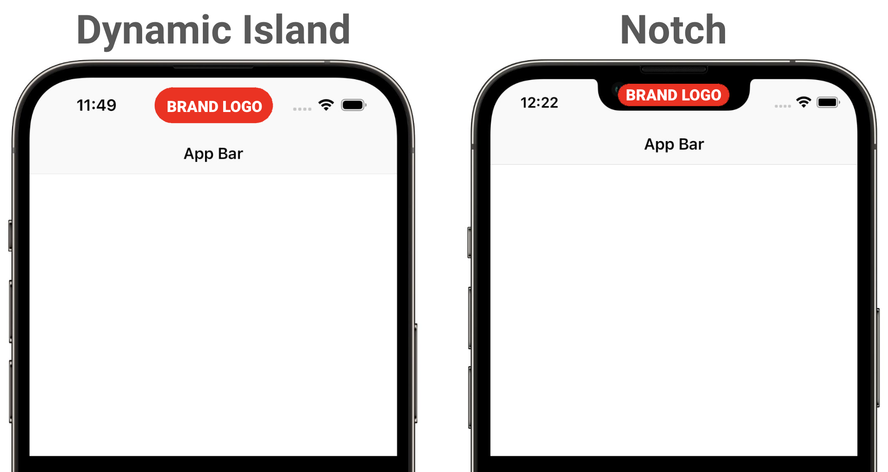

## Features

The **hidden_logo** plugin allows you to add any Flutter widget under the Notch or
the Dynamic Island for iPhones. It can be your brand logo or its simplified version.
The hardware cutout hides the logo during normal portrait use. It can appear in
screenshots, app-switcher previews or screen mirroring, depending on iOS capture timing.



<p align="left">
<a href="https://pub.dev/packages/hidden_logo"></a>
<a href="https://github.com/AndreySosnovyy/hidden_logo"></a>
</p>

❗No additional checks or manually written conditions are required when using `HiddenLogo`:<br>

- **Application running on any other devices not marked as target ones will not be
  affected**. Supported models range from iPhone X to iPhone 18 Pro and Pro Max. <br>
  You can see the [List of Target iPhones](#iphones-hardware-barrier-types-target-devices) separated by hardware barrier
  type (Notch or Dynamic Island) in the table down below.
- It provides **maximum size constraints for each supported iPhone** and clips
  content that paints outside those bounds.
- Corners of your Dynamic Island widget will be **rounded automatically**.
- Your logo is placed only in **portrait mode**.
- Logo constraints and Dynamic Island positioning adapt to iOS **Display Zoom**.

## Requirements

- Flutter ≥3.24.0
- iOS ≥13.0
- CocoaPods: Flutter ≥3.24.0
- Swift Package Manager: Flutter ≥3.27.0 on the stable channel

## Usage

Add the plugin with `flutter pub add hidden_logo`, then import
`package:hidden_logo/hidden_logo.dart`.

Wrap your `MaterialApp` or `CupertinoApp` with `HiddenLogo`, or use the app
`builder` as shown below. Use the app builder when your logo needs inherited
theme or localization, and place it at the full-screen app level.
Provide two builders: one for iPhones with a notch and one for Dynamic Island.
`MyNotchLogoBuilder` and `MyDynamicIslandLogoBuilder` below are your own widgets.

```dart
@override
Widget build(BuildContext context) {
  return MaterialApp(
    builder: (context, child) {
      return HiddenLogo(
        body: child!,
        notchBuilder: (context, constraints) {
          return MyNotchLogoBuilder();
        },
        dynamicIslandBuilder: (context, constraints) {
          return MyDynamicIslandLogoBuilder();
        },
      );
    },
    home: const Scaffold(
      body: Center(child: Text('App content')),
    ),
  );
}
```

The size of your brand logo can be adaptive thanks to constraints provided
by the widget. They define `maxWidth` and `maxHeight` where you can draw and remain hidden.<br>
Use the supplied constraints when sizing your logo. See the
[example app](example/README.md) for notch and Dynamic Island builders.

Also do not forget to define the `BorderRadius` property for your Notch logo widget,
so it nicely fits under the hardware barrier and is non-visible when not intended to.<br>

## Additional information

### Recommendations and tips

❌ Do not place ads or distracting content here. Use your brand or application logo.

❌ Do not place any important or sensitive information in the `HiddenLogo` widget.
Assume that users don't even see your widget there.

❌ Do not put interactive controls under the hardware barrier. The logo ignores
pointer events and is excluded from keyboard focus and accessibility semantics.

❌ Do not use the `HiddenLogo` widget if the top of the screen in your app already
has many details in app bars. Doing the opposite will make it look even more overloaded.

✅ Hide your HiddenLogo widget while the splashscreen is displayed. You can achieve this
by setting the `isVisible` property to `false` in the `HiddenLogo` widget.

✅ Set `visibilityMode: LogoVisibilityMode.onlyInBackground` to hide the logo
while the app is resumed. It is enabled in other lifecycle states, including
`inactive`, when the app may still be onscreen. iOS capture timing determines
whether it appears in a screenshot or app-switcher preview.

✅ If your brand's logo is complicated and has many small details you may want to
use a simplified version. Or just display its name.

✅ Feel free to slightly animate your child widget if needed. But don't overdo it!

### Debugging

To preview your logo, use `LogoVisibilityMode.always` and take a screenshot
(in the iOS simulator: Device → Trigger Screenshot). Compare it with the masked
simulator view to check that the logo stays behind the hardware cutout.

For `onlyInBackground`, also inspect an app-switcher preview on a real device,
since capture timing depends on iOS.

### iPhones hardware barrier types (Target devices)

| Notch      | Dynamic Island |
|:-----------|:---------------|
| X          | 14 Pro         |
| XR         | 14 Pro Max     |
| XS         | 15             |
| XS Max     | 15 Plus        |
| 11         | 15 Pro         |
| 11 Pro     | 15 Pro Max     |
| 11 Pro Max | 16             |
| 12         | 16 Plus        |
| 12 Mini    | 16 Pro         |
| 12 Pro     | 16 Pro Max     |
| 12 Pro Max | 17             |
| 13         | Air            |
| 13 Mini    | 17 Pro         |
| 13 Pro     | 17 Pro Max     |
| 13 Pro Max | 18 Pro         |
| 14         | 18 Pro Max     |
| 14 Plus    |                |
| 16e        |                |
| 17e        |                |

## About new devices support

New iPhones display no logo until their identifiers and cutout geometry are
verified and explicitly supported. iPhone Duo currently remains without a logo;
the app body is unaffected.

### Contribute 🛠

You can also contribute to this plugin on [GitHub](https://github.com/AndreySosnovyy/hidden_logo). <br>
Suggest your ideas or bug reports by opening an [issue](https://github.com/AndreySosnovyy/hidden_logo/issues/new) or
creating a [pull request](https://github.com/AndreySosnovyy/hidden_logo/pulls).

See [Contributing](CONTRIBUTING.md) for development checks and
[Changelog](CHANGELOG.md) for release history.
<br>
<br>
<br>
